<div align="center">

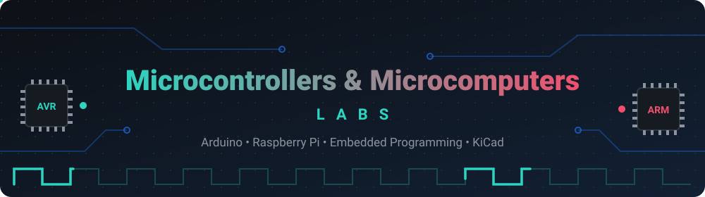

<a href="https://github.com/MIhajloS07/microcontrollers-and-microcomputers-labs">
  
</a>

<br/>

*A complete collection of 15 hands-on laboratory exercises from my Computer Engineering Technician studies — from reading a first UART sensor on an Arduino to a web-controlled robot and an IR-remote-driven Raspberry Pi.*

<br/>


-informational?style=flat-square)

</div>

<p align="center"></p>

## 📑 Table of Contents

- [About](#about)
- [Tech Stack](#tech-stack)
- [Labs at a Glance](#labs-at-a-glance)
- [Repository Structure](#repository-structure)
- [Part I – Arduino & Wired Protocols (Labs 1–6)](#part-i)
- [Part II – Raspberry Pi, Linux & Networking (Labs 7–10)](#part-ii)
- [Part III – Data, Vision & Robotics (Labs 11–15)](#part-iii)
- [Circuit Schematics (KiCad)](#schematics)
- [Getting Started](#getting-started)
- [Wiring & Safety Notes](#wiring-notes)
- [Skills Demonstrated](#skills)
- [Author](#author)
- [License](#license)

<p align="center"></p>

<a id="about"></a>
## 🧭 About

This repository contains the laboratory exercises I completed in the **Microcontrollers and Microcomputers** (and related **Computer Networks**) courses at *Tehnička škola „Rade Metalac“, Leskovac*, class **IV-4**, as part of my **Computer Engineering Technician** education.

The labs follow a natural learning path:

1. **Microcontroller basics** – read real sensors on an **Arduino** using the four most common serial buses: **UART, SPI, I²C and 1-Wire**.
2. **Connectivity** – serve sensor data over **Wi-Fi**, talk over **Bluetooth / BLE**, and connect an Arduino to a **Raspberry Pi**.
3. **Microcomputer & Linux** – manage a Raspberry Pi from a phone over **SSH**, control **GPIO**, and run **HTTP** and **WebSocket** servers.
4. **Real projects** – a **data-logging pipeline** (SQLite + pandas + matplotlib + Flask), a **PIR security camera**, a **web-controlled robot** (DC + servo + stepper), an **ultrasonic rangefinder**, and **infrared remote control** with a hand-written NEC decoder.

Every lab folder contains the **source code** and a **PDF report** (written in Serbian) with theory, wiring, and an explanation of the code. I have also extended the original assignments with **KiCad circuit schematics** (see [Circuit Schematics](#schematics)).

<p align="center"></p>

<a id="tech-stack"></a>
## 🛠️ Tech Stack

**Hardware platforms**

-00878F?style=flat-square&logo=arduino&logoColor=white)


**Languages**

-00599C?style=flat-square&logo=cplusplus&logoColor=white)


**Libraries & frameworks**


**Protocols & interfaces**


**Operating systems & tools**


<p align="center"></p>

<a id="labs-at-a-glance"></a>
## 🗂️ Labs at a Glance

| # | Lab | Platform | Protocol / Topic | Language |
|:-:|-----|----------|------------------|----------|
| [01](#lab-01) | UART sensor data reading | 🟦 Arduino UNO | UART | C++ |
| [02](#lab-02) | SPI sensor data reading (RFID) | 🟦 Arduino UNO | SPI | C++ |
| [03](#lab-03) | I²C sensor data reading + LCD | 🟦 Arduino UNO | I²C | C++ |
| [04](#lab-04) | 1-Wire sensor data reading | 🟦 Arduino UNO | 1-Wire / single wire | C++ |
| [05](#lab-05) | Sensor data on a web interface | 🟦 Arduino + ESP8266 | Wi-Fi, HTTP | C++ |
| [06](#lab-06) | Wired & Bluetooth / BLE communication | 🟦 Arduino / ESP32 | UART, Bluetooth, BLE | C++ |
| [07](#lab-07) | Communication with another single-board computer | 🟦 Arduino ↔ 🍓 Raspberry Pi | UART | C++, Python |
| [08](#lab-08) | Raspberry Pi ↔ mobile phone over cellular network | 🍓 Raspberry Pi | USB tethering, SSH | Bash |
| [09](#lab-09) | Digital inputs and outputs | 🍓 Raspberry Pi | GPIO, interrupts | Python |
| [10](#lab-10) | Web server & peripheral control | 🍓 Raspberry Pi | HTTP, WebSocket | Python, HTML, JS |
| [11](#lab-11) | Temperature data collection, analysis & visualization | 🍓 Raspberry Pi | SQLite, Flask | Python |
| [12](#lab-12) | PIR motion detection + camera | 🍓 Raspberry Pi | GPIO, OpenCV | Python |
| [13](#lab-13) | Motor control & web-controlled robot | 🍓 Raspberry Pi | PWM, Flask | Python, HTML |
| [14](#lab-14) | Ultrasonic distance measurement | 🍓 Raspberry Pi | Pulse timing | Python |
| [15](#lab-15) | Infrared sensing, remote control & navigation | 🍓 Raspberry Pi | NEC IR, PWM | Python |

<p align="center"></p>

<a id="repository-structure"></a>
## 📁 Repository Structure

```text
microcontrollers-and-microcomputers-labs/
├── 01-uart-sensor-data-reading/
│   ├── code/                 # Source code (firmware / scripts)
│   ├── schematics/           # KiCad project + exported schematic images
│   └── report.pdf            # Lab report (Serbian)
├── 02-spi-sensor-data-reading/
├── 03-i2c-sensor-data-reading/
├── 04-one-wire-sensor-data-reading/
├── 05-sensor-data-web-interface/
├── 06-wired-and-bluetooth-ble-communication/
├── 07-communication-with-another-single-board-computer/
├── 08-communication-with-mobile-phone-over-cellular-network/
│   ├── linux-commands.md     # Every Linux command used, explained
│   └── report.pdf
├── 09-digital-inputs-and-outputs/
├── 10-web-server-and-peripheral-control-on-raspberry-pi/
├── 11-temperature-sensor-data-collection-analysis-and-visualization/
│   ├── code/
│   ├── static/graph.png      # Generated comparison chart
│   └── report.pdf
├── 12-pir-motion-detection-and-camera-integration/
├── 13-motor-control-and-web-controlled-robot/
├── 14-ultrasonic-distance-measurement/
├── 15-infrared-sensing-remote-control-and-robot-navigation/
├── assets/                   # Animated SVGs used in this README
├── LICENSE
└── README.md
```

> **Naming convention:** `NN-topic-in-kebab-case/` → `code/` (sources), `schematics/` (KiCad), `report.pdf`.
> Arduino sketches are named `firmware*.ino`, Raspberry Pi programs `script*.py`.

<p align="center"></p>

<a id="part-i"></a>
# 🟦 Part I — Arduino & Wired Protocols

The first six labs use an **Arduino UNO (ATmega328P)** and cover the serial buses every embedded engineer meets sooner or later, then extend the board with Wi-Fi and Bluetooth.

<a id="lab-01"></a>
## 🌫️ Lab 01 — UART Sensor Data Reading

| | |
|---|---|
| **Goal** | Read particulate-matter concentration from a UART sensor |
| **Hardware** | Arduino UNO, **SDS011** air-quality (PM2.5 / PM10) sensor |
| **Protocol** | **UART** (asynchronous serial: TX / RX, baud rate, start/stop bits) |
| **Library** | `SdsDustSensor` |
| **Code** | [`firmware.ino`](./01-uart-sensor-data-reading/code/firmware.ino) |
| **Report** | [`report.pdf`](./01-uart-sensor-data-reading/report.pdf) |

<p align="center">
  
  <br/><sub><i>Animated: one UART byte (8N1) travelling bit by bit</i></sub>
</p>

**What it does**
- Queries the sensor firmware version, switches it to **active reporting mode** and sets a **continuous working period**.
- Reads `PM2.5` and `PM10` every 500 ms and prints them to the Serial Monitor; read errors are reported with a readable reason.
- The report compares **serial vs. parallel** communication and **synchronous vs. asynchronous** buses.

<a id="lab-02"></a>
## 💳 Lab 02 — SPI Sensor Data Reading

| | |
|---|---|
| **Goal** | Read RFID tags over SPI and act on a known tag |
| **Hardware** | Arduino UNO, **RC522 (MFRC522)** RFID reader, RFID tags, LED |
| **Protocol** | **SPI** (SCLK, MOSI, MISO, SS — master/slave, 4 wires) |
| **Library** | `SPI`, `MFRC522` |
| **Code** | [`firmware_01.ino`](./02-spi-sensor-data-reading/code/firmware_01.ino) · [`firmware_02.ino`](./02-spi-sensor-data-reading/code/firmware_02.ino) |
| **Report** | [`report.pdf`](./02-spi-sensor-data-reading/report.pdf) |

<p align="center">
  
  <br/><sub><i>Animated: an SPI transfer — SS, SCLK, MOSI, MISO (Mode 0)</i></sub>
</p>

**What it does**
- `firmware_01` — dumps full card info (**UID, SAK, card type, data blocks**) to the Serial Monitor at 115200 baud.
- `firmware_02` — reads the 4-byte UID, converts it to a string, and **toggles an LED** whenever the authorised tag is scanned (a simple access-control demo).

**Pins:** `RST = 9`, `SS = 10`, `LED = 8` (SCK/MOSI/MISO on the hardware SPI pins).

<a id="lab-03"></a>
## 🌡️ Lab 03 — I²C Sensor Data Reading

| | |
|---|---|
| **Goal** | Read an environmental sensor and show the values on an I²C LCD |
| **Hardware** | Arduino UNO, **BME680** (temperature / humidity / pressure / gas), **16×2 LCD with I²C backpack** |
| **Protocol** | **I²C** (SDA + SCL, addressing, ACK, pull-up resistors) |
| **Libraries** | `Adafruit_BME680`, `Adafruit_Sensor`, `LiquidCrystal_I2C`, `Wire` |
| **Code** | [`firmware_01.ino`](./03-i2c-sensor-data-reading/code/firmware_01.ino) · [`firmware_02.ino`](./03-i2c-sensor-data-reading/code/firmware_02.ino) |
| **Report** | [`report.pdf`](./03-i2c-sensor-data-reading/report.pdf) |

<p align="center">
  
  <br/><sub><i>Animated: an I²C write — START, address, R/W, ACK, STOP</i></sub>
</p>

**What it does**
- `firmware_01` — configures oversampling (T ×8, H ×2, P ×4), an IIR filter and the gas heater (**320 °C / 150 ms**), then prints temperature (°C), pressure (hPa), humidity (%) and gas resistance (kΩ) every 2 s.
- `firmware_02` — same measurements, additionally rendered on an **I²C LCD (address `0x27`)** with a degree symbol, in a compact `T / H / P` layout.
- The report explains why a LCD normally needs 16 wires and how the **I²C backpack** reduces that to 2.

<a id="lab-04"></a>
## 💧 Lab 04 — 1-Wire Sensor Data Reading

| | |
|---|---|
| **Goal** | Read temperature and humidity over a single data wire |
| **Hardware** | Arduino UNO, **DHT11** (configurable to DHT21 / DHT22) |
| **Protocol** | Single-wire digital protocol |
| **Library** | `DHT` |
| **Code** | [`firmware_01.ino`](./04-one-wire-sensor-data-reading/code/firmware_01.ino) |
| **Report** | [`report.pdf`](./04-one-wire-sensor-data-reading/report.pdf) |

**What it does**
- Reads humidity and temperature on **pin 2** every 2 s and validates the result with `isnan()` before printing.
- The report covers the theory behind temperature measurement and **thermistors (NTC / PTC)**.

<a id="lab-05"></a>
## 🌐 Lab 05 — Sensor Data on a Web Interface

| | |
|---|---|
| **Goal** | Publish live sensor readings as a web page |
| **Hardware** | Arduino UNO, **DHT11**, **ESP8266** Wi-Fi module (ESP-01 variant) |
| **Protocol** | **Wi-Fi + HTTP** (Arduino ↔ ESP8266 over UART with AT commands) |
| **Code** | [`firmware_01.ino`](./05-sensor-data-web-interface/code/firmware_01.ino) |
| **Report** | [`report.pdf`](./05-sensor-data-web-interface/report.pdf) |

**What it does**
- Connects to a local Wi-Fi network, prints the **DHCP-assigned IP address** and starts an **HTTP server on port 80**.
- Every request returns an HTML page with the current temperature and humidity; the page **auto-refreshes every 3 s** via `<meta http-equiv="refresh">`.
- Hardware notes from the report: ESP-01 `CH_EN` must be tied to **3.3 V**, and a **voltage divider** brings the Arduino's 5 V TX level down to ~3.3 V for the ESP8266 RX pin.

> ⚠️ Replace `your_wifi_ssid` / `your_wifi_password` in the sketch with your own credentials before uploading.

<a id="lab-06"></a>
## 📡 Lab 06 — Wired & Bluetooth / BLE Communication

| | |
|---|---|
| **Goal** | Talk to a microcontroller over a cable, classic Bluetooth and Bluetooth Low Energy |
| **Hardware** | Arduino UNO + Bluetooth serial module (HC-05 / HC-06 class), **ESP32** |
| **Protocols** | **UART (USB)**, **Bluetooth Classic (SPP)**, **BLE (GATT)** |
| **Code** | [`firmware_01.ino`](./06-wired-and-bluetooth-ble-communication/code/firmware_01.ino) · [`firmware_02.ino`](./06-wired-and-bluetooth-ble-communication/code/firmware_02.ino) |
| **Report** | [`report.pdf`](./06-wired-and-bluetooth-ble-communication/report.pdf) |

**What it does**
- `firmware_01` — a **transparent Bluetooth ⇄ Serial bridge** using `SoftwareSerial` (RX = 10, TX = 11, 9600 baud): whatever the phone sends appears in the Serial Monitor and vice versa.
- `firmware_02` — an **ESP32 BLE GATT server** named `ESP32_BLE` exposing the standard **Battery Service (`0x180F`)** with a *Battery Level* characteristic (`0x2A19`, **read + notify**); a random value (0–100) is pushed to the connected client every 2 s.
- Test with a Bluetooth terminal app (classic) or **nRF Connect** (BLE).

<p align="center"></p>

<a id="part-ii"></a>
# 🍓 Part II — Raspberry Pi, Linux & Networking

From here on the labs move to a **Raspberry Pi (Raspberry Pi OS / Debian Linux)**: a full computer with an operating system, networking and a Python ecosystem.

<a id="lab-07"></a>
## 🔗 Lab 07 — Communication with Another Single-Board Computer

| | |
|---|---|
| **Goal** | Control an Arduino from a Raspberry Pi over a serial link |
| **Hardware** | Arduino UNO, Raspberry Pi 400 |
| **Protocol** | **UART** — Arduino pins 0/1 ↔ Pi `GPIO14` (TX) / `GPIO15` (RX), 9600 baud |
| **Libraries** | `pyserial`, `RPi.GPIO`, `threading` |
| **Code** | [`firmware_01.ino`](./07-communication-with-another-single-board-computer/code/firmware_01.ino) · [`scriptRpi.py`](./07-communication-with-another-single-board-computer/code/scriptRpi.py) |
| **Report** | [`report.pdf`](./07-communication-with-another-single-board-computer/report.pdf) |

A tiny **text command protocol** between the two boards:

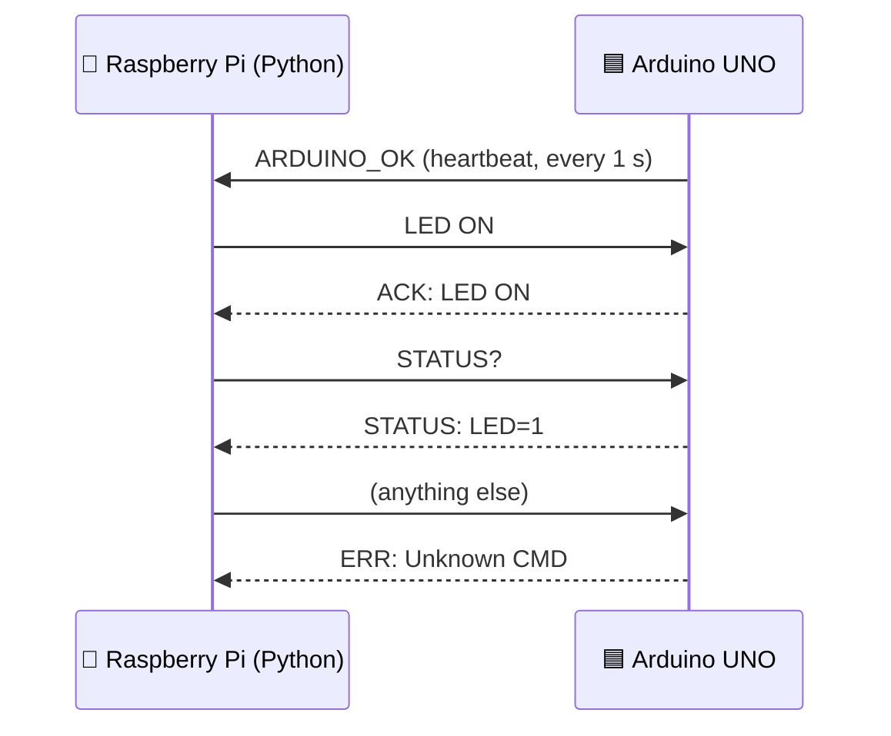

- The Arduino drives the LED on **pin 13** and answers with `ACK` / `STATUS` / `ERR` messages.
- The Python script receives data in a **background thread** while the main loop reads user commands (`LED ON`, `LED OFF`, `STATUS?`).
- ⚠️ The Pi works at **3.3 V logic** while the Arduino UNO works at **5 V** — see [Wiring & Safety Notes](#wiring-notes).

<a id="lab-08"></a>
## 📱 Lab 08 — Raspberry Pi ↔ Mobile Phone over Cellular Network

| | |
|---|---|
| **Goal** | Use the Raspberry Pi's Linux terminal from a phone — no monitor needed |
| **Hardware** | Raspberry Pi, Android phone (Xiaomi Redmi Note 13), USB cable |
| **Technologies** | **USB tethering**, **SSH**, Wi-Fi / hotspot, NetworkManager |
| **Docs** | [`linux-commands.md`](./08-communication-with-mobile-phone-over-cellular-network/linux-commands.md) |
| **Report** | [`report.pdf`](./08-communication-with-mobile-phone-over-cellular-network/report.pdf) |

**Workflow**
1. Connect the Pi and the phone with a USB cable and enable **USB tethering** on the phone.
2. Find the Pi's address (`ip addr show wlan0`) and verify connectivity (`ping -c 4 google.com`).
3. Configure Wi-Fi (`wpa_supplicant.conf`) and apply it with `wpa_cli`.
4. Enable and start the **SSH service** (`systemctl enable/start/status ssh`).
5. Use an SSH client app on the phone (e.g. Termius, JuiceSSH) with the Pi's IP, user name and password.
6. Optionally serve files with `python3 -m http.server 8000` and open them from the phone's browser.

📖 All commands are documented one by one in [`linux-commands.md`](./08-communication-with-mobile-phone-over-cellular-network/linux-commands.md).

<a id="lab-09"></a>
## 💡 Lab 09 — Digital Inputs and Outputs

| | |
|---|---|
| **Goal** | Learn GPIO on the Raspberry Pi: output, input, and interrupts |
| **Hardware** | Raspberry Pi, LED (+ resistor), push button |
| **Library** | `RPi.GPIO` (BCM numbering) |
| **Pins** | LED → `GPIO18`, Button → `GPIO17` (internal pull-up) |
| **Code** | [`scriptRPi_01.py`](./09-digital-inputs-and-outputs/code/scriptRPi_01.py) · [`scriptRPi_02.py`](./09-digital-inputs-and-outputs/code/scriptRPi_02.py) · [`scriptRPi_03.py`](./09-digital-inputs-and-outputs/code/scriptRPi_03.py) |
| **Report** | [`report.pdf`](./09-digital-inputs-and-outputs/report.pdf) |

<p align="center">
  
  <br/><sub><i>Animated: GPIO18 toggling an LED through a resistor</i></sub>
</p>

| Script | Behaviour |
|--------|-----------|
| `scriptRPi_01.py` | **Blink** — LED on for 1 s, off for 1 s |
| `scriptRPi_02.py` | **Polling** — LED lights while the button is held (active-low with pull-up) |
| `scriptRPi_03.py` | **Interrupt** — falling-edge event detection **toggles** the LED, with **300 ms debounce** |

The report also introduces the **Raspberry Pi 400** (BCM2711 quad-core Cortex-A72 @ 1.8 GHz, 4 GB RAM) and how a microcomputer differs from a microcontroller.

<a id="lab-10"></a>
## 🌍 Lab 10 — Web Server & Peripheral Control on Raspberry Pi

| | |
|---|---|
| **Goal** | Control hardware from a browser — first with HTTP, then with WebSockets |
| **Hardware** | Raspberry Pi, LED on `GPIO18` |
| **Protocols** | **HTTP** (port `8080`), **WebSocket** (port `8765`) |
| **Libraries** | `http.server`, `websockets`, `asyncio`, `RPi.GPIO` |
| **Code** | [`httpServer.py`](./10-web-server-and-peripheral-control-on-raspberry-pi/code/httpServer.py) · [`httpserverIndex.html`](./10-web-server-and-peripheral-control-on-raspberry-pi/code/httpserverIndex.html) · [`websocketServer.py`](./10-web-server-and-peripheral-control-on-raspberry-pi/code/websocketServer.py) · [`websocketServerIndex.html`](./10-web-server-and-peripheral-control-on-raspberry-pi/code/websocketServerIndex.html) |
| **Report** | [`report.pdf`](./10-web-server-and-peripheral-control-on-raspberry-pi/report.pdf) |

| | HTTP server | WebSocket server |
|---|---|---|
| **Style** | Request / response — each click is a new request | One persistent, **full-duplex** connection |
| **Routes / messages** | `GET /on`, `GET /off`, anything else serves the page | `"ON"` / `"OFF"` → server replies `LED TURNED ON/OFF` |
| **Best for** | Simple pages and APIs | **Real-time** control and live status |
| **Open** | `http://<pi-ip>:8080` | `ws://<pi-ip>:8765` (page shows live status) |

> 💡 In `websocketServerIndex.html` replace `IP_ADDRESS` with your Raspberry Pi's IP address.

<p align="center"></p>

<a id="part-iii"></a>
# 🚀 Part III — Data, Vision & Robotics

The final five labs combine sensors, databases, computer vision, motors and wireless control into small complete systems.

<a id="lab-11"></a>
## 📈 Lab 11 — Temperature Data Collection, Analysis & Visualization

| | |
|---|---|
| **Goal** | Read two sensors, store the data, analyse it and show a chart in the browser |
| **Hardware** | Raspberry Pi, 2 × **DHT11** (`GPIO4` and `GPIO17`) |
| **Libraries** | `adafruit_dht`, `sqlite3`, `pandas`, `matplotlib`, `Flask` |
| **Code** | [`scriptRPi.py`](./11-temperature-sensor-data-collection-analysis-and-visualization/code/scriptRPi.py) · [`database.py`](./11-temperature-sensor-data-collection-analysis-and-visualization/code/database.py) · [`analysis.py`](./11-temperature-sensor-data-collection-analysis-and-visualization/code/analysis.py) · [`visualisation.py`](./11-temperature-sensor-data-collection-analysis-and-visualization/code/visualisation.py) · [`app.py`](./11-temperature-sensor-data-collection-analysis-and-visualization/code/app.py) |
| **Report** | [`report.pdf`](./11-temperature-sensor-data-collection-analysis-and-visualization/report.pdf) |

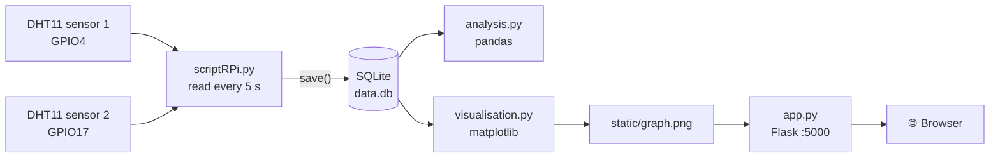

- `database.py` creates the `dht_data(time, t1, h1, t2, h2)` table and provides a `save()` helper.
- `analysis.py` prints the **average temperature of each sensor** and the **average difference** between them.
- `visualisation.py` plots both temperature series; `app.py` serves the chart with **Flask** on port `5000`.

**Result — comparison of the two sensors over time:**

<p align="center">
  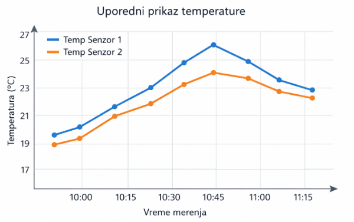
</p>

<a id="lab-12"></a>
## 🎥 Lab 12 — PIR Motion Detection & Camera Integration

| | |
|---|---|
| **Goal** | Build a simple motion-triggered video-surveillance system |
| **Hardware** | Raspberry Pi, **HC-SR501 PIR** sensor (`GPIO17`), USB / Pi camera |
| **Libraries** | `RPi.GPIO`, `OpenCV (cv2)` |
| **Code** | [`testscript.py`](./12-pir-motion-detection-and-camera-integration/code/testscript.py) · [`cameracapture.py`](./12-pir-motion-detection-and-camera-integration/code/cameracapture.py) · [`videocapture.py`](./12-pir-motion-detection-and-camera-integration/code/videocapture.py) |
| **Report** | [`report.pdf`](./12-pir-motion-detection-and-camera-integration/report.pdf) |

<p align="center">
  
  <br/><sub><i>Animated: motion enters the PIR zone → GPIO17 goes HIGH → the camera fires</i></sub>
</p>

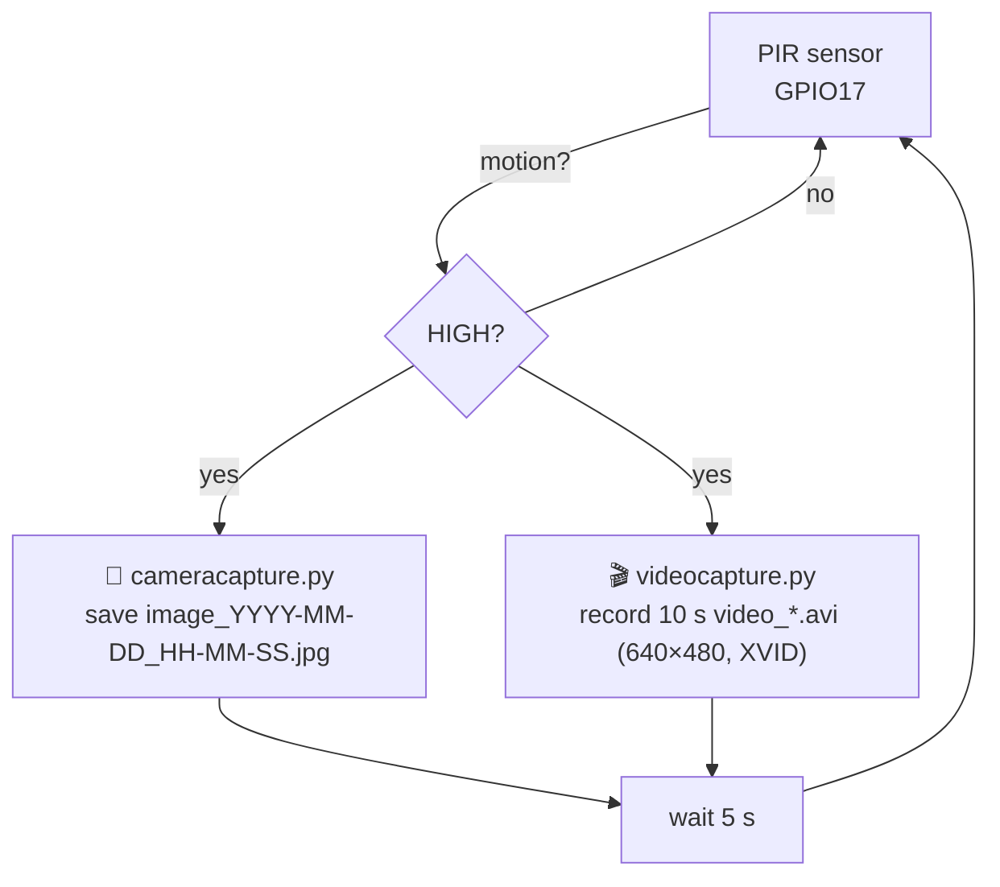

| Script | Purpose |
|--------|---------|
| `testscript.py` | Sanity check — prints *Motion detected / No motion detected* |
| `cameracapture.py` | Takes a **timestamped photo** on every detection |
| `videocapture.py` | Records a **10-second timestamped video** on every detection |

The report explains how a PIR sensor works: pyroelectric crystal, **Fresnel lens**, and the 8–14 µm infrared band emitted by the human body.

<a id="lab-13"></a>
## 🤖 Lab 13 — Motor Control & Web-Controlled Robot

| | |
|---|---|
| **Goal** | Drive DC, servo and stepper motors from a web page — the basis of a 2–4 wheel robot |
| **Hardware** | Raspberry Pi, **DC motor** + H-bridge driver, **servo**, **28BYJ-48 stepper** + **ULN2003** driver |
| **Libraries** | `Flask`, `RPi.GPIO` (software PWM) |
| **Code** | [`app.py`](./13-motor-control-and-web-controlled-robot/code/app.py) · [`index.html`](./13-motor-control-and-web-controlled-robot/code/index.html) |
| **Report** | [`report.pdf`](./13-motor-control-and-web-controlled-robot/report.pdf) |

<p align="center">
  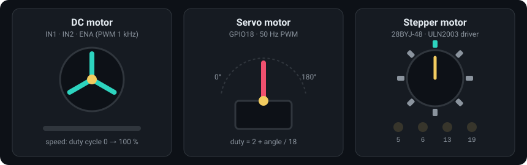
  <br/><sub><i>Animated: DC motor (PWM speed), servo (0–180°) and stepper (half-steps)</i></sub>
</p>

| Motor | Pins (BCM) | Control |
|-------|-----------|---------|
| **DC motor** | `IN1 = 17`, `IN2 = 27`, `ENA = 22` | Direction via IN1/IN2, **speed via 1 kHz PWM** (0–100 %) |
| **Servo** | `GPIO18` | **50 Hz PWM**, angle 0–180° → duty cycle `2 + angle/18` |
| **Stepper (28BYJ-48)** | `5, 6, 13, 19` | 8-phase half-step sequence, forward / backward |

Web endpoints (`POST`): `/dc` (speed + direction), `/servo` (angle), `/stepper` (direction). The page is served on port `5000`.

> 💡 Flask's `render_template` looks for a `templates/` folder — when running the app, place `index.html` in `templates/` next to `app.py`.

<a id="lab-14"></a>
## 📏 Lab 14 — Ultrasonic Distance Measurement

| | |
|---|---|
| **Goal** | Measure distance with an ultrasonic sensor |
| **Hardware** | Raspberry Pi, **HC-SR04** ultrasonic sensor (`TRIG = GPIO23`, `ECHO = GPIO24`) |
| **Library** | `RPi.GPIO`, `time` |
| **Code** | [`scripyRPi.py`](./14-ultrasonic-distance-measurement/code/scripyRPi.py) |
| **Report** | [`report.pdf`](./14-ultrasonic-distance-measurement/report.pdf) |

<p align="center">
  
  <br/><sub><i>Animated: ultrasonic burst out, echo back — distance from the round-trip time</i></sub>
</p>

**How it works:** a 10 µs pulse on `TRIG` makes the sensor emit an ultrasonic burst; the script times how long `ECHO` stays high, and converts it to distance:

```text
distance [cm] = (echo_time [s] × 34300) / 2
```

Speed of sound ≈ 343 m/s = 34300 cm/s; the result is divided by 2 because the sound travels to the object **and back**. The `ECHO` output of the sensor must be brought down to 3.3 V for the Pi's GPIO (see [notes](#wiring-notes)).

<a id="lab-15"></a>
## 📺 Lab 15 — Infrared Sensing, Remote Control & Robot Navigation

| | |
|---|---|
| **Goal** | Decode an IR remote and use it to control a device |
| **Hardware** | Raspberry Pi, **TSOP38238** IR receiver (`GPIO17`), IR remote, LED (`GPIO18`) |
| **Protocol** | **NEC infrared protocol** (38 kHz carrier), LED dimming via **PWM** |
| **Library** | `RPi.GPIO`, `time.perf_counter` |
| **Code** | [`scriptRPi.py`](./15-infrared-sensing-remote-control-and-robot-navigation/code/scriptRPi.py) |
| **Report** | [`report.pdf`](./15-infrared-sensing-remote-control-and-robot-navigation/report.pdf) |

<p align="center">
  
  <br/><sub><i>Animated: decoding an NEC infrared frame pulse by pulse</i></sub>
</p>

The script contains a **hand-written NEC decoder** — no IR library:

```text
NEC frame:  [ 9 ms burst ][ 4.5 ms space ][ 32 data bits ]
bit "0":    ~560 µs pulse + ~560 µs space
bit "1":    ~560 µs pulse + ~1.7 ms space
```

| Remote button | Code | Action |
|---------------|------|--------|
| ON / OFF | `0xFFC23D` | Toggle the LED |
| `+` | `0xFFA857` | Brightness +15 % |
| `−` | `0xFFE01F` | Brightness −15 % |

Timeouts on every edge make the decoder robust against noise, and repeat codes (`0xFFFFFFFF`) are ignored. The report discusses applying the same IR control to **robot movement**.

<p align="center"></p>

<a id="schematics"></a>
## 🧩 Circuit Schematics (KiCad)

On top of the original assignments, I redrew the wiring of the labs as proper schematics in **KiCad** (the open-source EDA suite for schematic capture and PCB design).

Each lab folder keeps its schematics in a `schematics/` subfolder:

```text
NN-lab-name/
└── schematics/
    ├── <project>.kicad_pro      # KiCad project
    ├── <project>.kicad_sch      # Schematic source
    └── <project>.png / .pdf     # Exported image for quick viewing
```

<!--
When the schematic images are added, show them inside each lab section, e.g.:

<p align="center">
  
</p>
-->

<p align="center"></p>

<a id="getting-started"></a>
## ⚙️ Getting Started

### 1. Clone the repository

```bash
git clone https://github.com/MIhajloS07/microcontrollers-and-microcomputers-labs.git
cd microcontrollers-and-microcomputers-labs
```

### 2. Arduino labs (01–06)

Open the `.ino` file in the **Arduino IDE** (Windows / Linux / macOS), select the board and port, and upload. Install the libraries via **Sketch → Include Library → Manage Libraries**:

| Lab | Libraries / board packages |
|:---:|----------------------------|
| 01 | `SdsDustSensor` |
| 02 | `MFRC522` (SPI is built in) |
| 03 | `Adafruit BME680 Library`, `Adafruit Unified Sensor`, `LiquidCrystal I2C` |
| 04 | `DHT sensor library` (+ `Adafruit Unified Sensor`) |
| 05 | `DHT sensor library`, ESP8266 board package |
| 06 | `SoftwareSerial` (built in); **ESP32** board package for the BLE sketch |

Set the Serial Monitor to the baud rate used in the sketch (`9600` or `115200`).

### 3. Raspberry Pi labs (07–15)

Tested on **Raspberry Pi OS** (Debian-based Linux). Install the Python dependencies you need:

```bash
sudo apt update
sudo apt install python3-pip python3-opencv python3-pandas python3-matplotlib python3-flask python3-serial python3-rpi.gpio

# Lab 10 (WebSocket) and Lab 11 (DHT sensors)
pip3 install websockets adafruit-circuitpython-dht --break-system-packages
```

Run a script (GPIO access normally needs no `sudo` on Raspberry Pi OS):

```bash
python3 09-digital-inputs-and-outputs/code/scriptRPi_03.py
```

### 4. Quick run reference

| Lab | Command | Then open |
|:---:|---------|-----------|
| 07 | `python3 scriptRpi.py` | type `LED ON`, `LED OFF`, `STATUS?` |
| 08 | `python3 -m http.server 8000` | `http://<pi-ip>:8000` |
| 10 | `python3 httpServer.py` | `http://<pi-ip>:8080` |
| 10 | `python3 websocketServer.py` | open `websocketServerIndex.html` |
| 11 | `python3 app.py` | `http://<pi-ip>:5000` |
| 13 | `python3 app.py` | `http://<pi-ip>:5000` |
| 12, 14, 15 | `python3 <script>.py` | watch the terminal output |

Press **Ctrl + C** to stop any script — each one cleans up its GPIO pins on exit.

<p align="center"></p>

<a id="wiring-notes"></a>
## ⚠️ Wiring & Safety Notes

- **Voltage levels matter.** Raspberry Pi GPIO is **3.3 V only**; an Arduino UNO outputs **5 V**. Use a **level shifter or a voltage divider** (as in Lab 05) on any 5 V → Pi line (Lab 07 UART, Lab 14 `ECHO`).
- **ESP8266 is a 3.3 V device** — never feed it 5 V logic directly.
- **Use current-limiting resistors** with LEDs, and **never power motors from a GPIO pin** — always use a driver (H-bridge / ULN2003) and a suitable supply (Lab 13).
- **I²C needs pull-up resistors** (typically 4.7 kΩ) — most breakout modules already include them.
- **Don't commit secrets.** Wi-Fi SSIDs and passwords in the sketches and `wpa_supplicant.conf` are placeholders; IP addresses will differ on your network.

<p align="center"></p>

<a id="skills"></a>
## 🎓 Skills Demonstrated

| Area | What the labs cover |
|------|---------------------|
| **Embedded programming** | Arduino C++ sketches, sensor libraries, serial debugging, `SoftwareSerial`, BLE GATT |
| **Communication protocols** | UART, SPI, I²C, single-wire, HTTP, WebSocket, Bluetooth, BLE, NEC IR, SSH |
| **Linux & networking** | Raspberry Pi OS, `systemctl`, `wpa_supplicant`, IP configuration, SSH, USB tethering |
| **Python** | GPIO, threading, `asyncio`, Flask, SQLite, pandas, matplotlib, OpenCV |
| **Web** | HTML pages, REST-style routes, real-time WebSocket UI |
| **Hardware interfacing** | Sensors (PM, RFID, environmental, PIR, ultrasonic, IR), actuators (LED, DC, servo, stepper), drivers, level shifting |
| **Electronics design** | Schematic capture in **KiCad** |
| **Documentation** | Structured lab reports, command references, reproducible repository layout |

<p align="center"></p>

<a id="author"></a>
## 👤 Author

**Mihajlo Stoiljković** — Computer Engineering Technician student

[](https://github.com/MIhajloS07)

<p align="center"></p>

<a id="license"></a>
## 📄 License

This project is licensed under the **MIT License** — see the [LICENSE](./LICENSE) file for details.

<div align="center">

⭐ *If this repository helped you with your own labs, consider giving it a star!* ⭐


</div>
